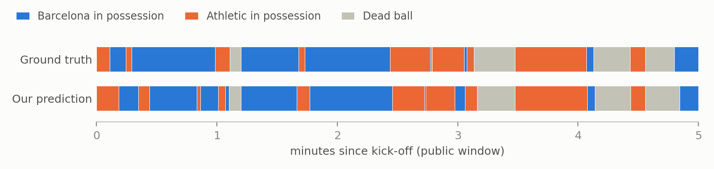
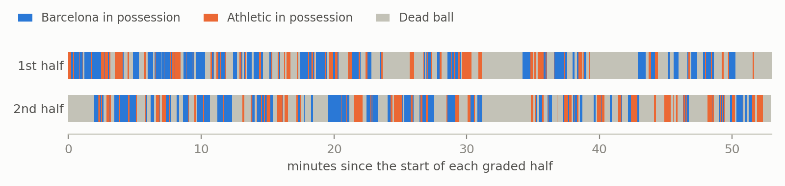

# Frame-level ball possession from automatic tracking

**Team Yamal Fan Boys** · More than a Hack 2027, Phase 1 · FC Barcelona vs Athletic Club

## 1. Summary

We split the task in two, because the two halves fail in different ways:

1. **Is the ball in play?** A hidden Markov model over the whole match decides alive vs dead from
   four weak but independent signals: whether the **TV broadcast** is showing live play, what the
   tracked ball is doing, how fast the players move, and the Smart Tagging set-piece windows. Its
   parameters are learned by EM on the full match. The edges of each stoppage are then moved to
   the moment the ball left the pitch (seen or extrapolated) and to the restart kick.
2. **While it is in play, which team has it?** The team that took the restart keeps the ball until
   a player of the other team *holds* it: within 1.25 m of the ball, nearer than any opponent, for
   8 consecutive frames (0.32 s). Loose balls, passes in flight and brief contests leave possession
   where it was.

On the public five minutes the official scorer gives **spellF1 0.573** and **macroF1 0.891**,
against 0.326 and 0.621 for the published baseline (§5). The public window holds only 17
possessions, so we used it as a sanity check and chose between variants on labels we made from
the tactical video (§6).

## 2. Assets used

| asset | used for |
|---|---|
| tactical tracking (ATD) | everything: ball, player positions, speeds, team membership |
| broadcast tracking | aligning the broadcast to the tactical clock (§4.2) |
| broadcast homography `valid` flag | "is the TV showing live play?" — the strongest dead-ball signal |
| Smart Tagging | set-piece windows as one HMM channel |
| public 5-minute ground truth | initialising the HMM and fixed counts in EM; sanity checks |
| tactical homography + video | validation only: overlays and the labels in §6 |
| broadcast ball | **dropped**: raises ball coverage only from 59% to 64% of graded frames, and disagrees with the tactical ball by > 5 m on 13% of shared frames |
| broadcast near-ball positions | **dropped** for control: agree with the ground truth less often than the tactical ones (0.87 vs 0.91) |
| videos in the pipeline | **not used**: the submission needs only the tracking, homography and tagging files |

## 3. What the data told us

- **Most of the missing ball is dead time, not hidden play.** The tactical ball is missing on 41%
  of graded frames, in long gaps (median 10.7 s). Where it is missing, the broadcast has usually
  cut away and the players are walking. Live-play gaps longer than 2 s add up to about 5 minutes.
- **The broadcast director is a dead-ball detector.** The broadcast shows live play on 96–97% of
  in-play frames but on only 24% of dead-ball frames in the public window: it cuts to close-ups
  and replays when play stops. Replays often run on for a few seconds after the restart, so the
  cut-away marks a stoppage well but lags its end.
- **The two recordings share one clock per half**: tactical = broadcast + 4014 frames in the first
  half, + 26920 in the second. Replays replace live footage; they do not shift the clock.
- **Brief possessions are real.** The ground truth contains 0.8 s and 1.3 s possessions inside
  duels, so heavy smoothing cannot be the answer.
- **About half the graded time is dead ball** (we predict 50%), which fits LaLiga's low effective
  playing time; this match has two 3–4 minute breaks and long stoppages after goals.

## 4. Method

### 4.1 Handling missing and noisy tracking (`possession/features.py`)
Positions are converted to metres from the pitch centre. Ball points that jump faster than 40 m/s
away from both neighbours are removed, detections shorter than 3 frames dropped, the track
smoothed over 5 frames and gaps up to 12 frames filled linearly. Longer gaps are left missing on
purpose: the HMM treats "ball not seen" as evidence in its own right, and possession during play
is carried through a gap until the ball is seen with the other team. Player speeds are computed
from positions (the provided ball speed is empty 91% of the time); impossible speeds caused by
identity switches are discarded.

### 4.2 Broadcast alignment (`possession/broadcast.py`)
Both tracking files use the same pitch coordinates, so a broadcast frame showing live play has a
tactical twin with the same player layout. For anchors every 2 s we search every 5th tactical frame
(same-team nearest-neighbour distance plus the ball, numba), then refine to the exact frame. 88% of
confident matches fall within ±2 frames of two offsets; the rest are replays, which match the
earlier moment they show. We use one offset per half (the median of the matches near each mode):
a rolling estimate was dragged by replays during a 3-minute break.

### 4.3 Alive / dead (`possession/alivehmm.py`)
- Observations at 5 Hz: broadcast live / cut away / no frame; ball not seen / out / still / slow /
  fast; mean player speed over 3 s (7 bins); next 3 s minus last 3 s (5 bins); inside a Smart
  Tagging set-piece window.
- States: alive, and a chain of 15 dead sub-states, so a stoppage lasts at least 3 s.
- Baum–Welch on both halves, the public labels entering as fixed counts. Fitted without them, the
  public score is the same, so they are not what makes it work.
- Each channel's dead-vs-alive log-ratio is capped at 2 nats per step, so that no single signal
  can overrule the others (slow players alone made slow restarts look dead). Lower caps start to
  drop stoppages we verified on the video.
- A frame is dead when the posterior exceeds 0.5. Live slivers under 3 s in which nobody has the
  ball are folded into the surrounding stoppage. The published pre-kick-off period of the second
  half (110808–113741) is dead.

### 4.4 Stoppage edges (`possession/deadball.py`)
The HMM's onset trails the real one, because its evidence follows the whistle. It is moved to:

1. the earliest frame in the 10 s before where the ball is seen crossing a line and staying out;
2. otherwise the frame the ball left the pitch unseen: last seen within 3 m of a line and moving
   towards it (or on it), then not seen for 10 frames, crossing extrapolated from its speed. This
   only applies if play was still live: the fastest tenth of the players must have been running
   (> 2.5 m/s) in the 2 s before, because after a whistle the ball often rolls out while everybody
   has already stopped;
3. otherwise 60 frames earlier, the median lag we measured on video (spread 5–150 frames).

The restart is moved to the strongest kick of a ball at rest within ±2 s of the predicted one.

### 4.5 Possession rules
**Dead ball** is `D`, whoever will restart.

**Restarts.** The team taking the restart owns the ball from the restart frame
(`possession/team.py: infer_restart`), decided in this order:

1. ball seen just before the restart at a corner → the team attacking that goal; in a penalty
   area → goal kick or defensive free kick by the team defending it;
2. otherwise the team of the player within 3 m of the ball (opponents must stand back);
3. ball not seen but ≥ 9 players in a penalty area → a set piece by the team attacking it;
4. otherwise the first team to control the ball.

Kick-offs follow the Laws of the Game: whoever kicks off the first half does not kick off the
second.

**During play** (`possession/team.py: hysteresis`): possession passes when the other team holds
control (nearest player within 1.25 m of the seen ball and nearer than any opponent) for 8
consecutive frames, dated to the start of that control. A loose ball, a pass in flight, a
deflection or a 50/50 shorter than that leaves possession with the last team.

## 5. Results

Official scorer (`evaluation/run_evaluation.py`, unchanged) on the public five minutes, with
5–95% bootstrap intervals over possessions:

| submission | spellF1 | macroF1 | possessions (truth 17) | dead-ball F1 |
|---|---|---|---|---|
| **Yamal Fan Boys** | **0.573** (0.43–0.71) | **0.891** (0.79–0.92) | 20 | 0.950 |
| baseline_smooth50 (published floor) | 0.326 (0.21–0.45) | 0.621 (0.46–0.74) | 26 | 0.323 |
| baseline_raw | 0.038 | 0.597 | 131 | 0.420 |



Every stoppage in the public window is found, with onsets within 2–41 frames and restarts within
6 frames except a goal kick (65 frames late). The possession blocks match; the differences are
timing at hand-overs and a few brief possessions in duels.



Over the match we predict 339 possessions (mean 9.4 s) and 112 stoppages; the ball is dead on
50% of graded frames.

## 6. Validation on the video

Beyond the public five minutes the ground truth is private, and the rules allow hand-labelled data
for validation. We made a frame-exact 720p copy of the tactical video (`tools/`), checked it frame
by frame against the tracking, and labelled from it:

| what we checked | how | result |
|---|---|---|
| team taking each restart | 64 restarts labelled (`validation/restarts_visual.csv`) | 52/64 → **61/64** with §4.5 |
| predicted stoppages | middle frame of all 95 covered by the video | long ones all genuine; the doubtful short ones are what the evidence cap removes |
| short stoppages | 11 sequences | throw-ins and fouls kept, slow build-up no longer called dead |
| stoppage onsets | 14 sequences | the 6 we could time are within 17 frames |
| restart timing | 6 restarts followed for 8 s | play live from the predicted frame each time |
| set pieces | 58 Smart Tagging set pieces | 57 have a predicted restart nearby |
| possession switches | 36 sampled | ≥ 2 s reliable; < 2 s about half are duels, scrambles or aerial balls |

These labels never enter the pipeline; they only decided between variants.

## 7. What we tried and dropped

- **Nearest player + majority vote** (the baseline): flickers, and the window that removes the
  flicker also removes short possessions.
- **Viterbi over per-frame touch evidence**, with and without a ball-free team-shape model (85%
  accurate on its own): under-segments, because the ground truth flips on brief control that any
  switching penalty strong enough to suppress noise also removes.
- **A dead-ball classifier on rule-based pseudo-labels:** learned the labelling rule back ("ball not
  seen ⇒ dead") instead of the stoppage.
- **Merging back-and-forth possessions under 1 s:** removed most of the duel flickers we judged
  false on video, but the ground truth itself contains such a possession in a duel.
- **Counting control only when the ball is slow** (to ignore balls in the air), or only where the
  broadcast tracking agrees: cleaner evidence, but real switches were lost with the false ones.

## 8. Limitations

- Team errors come from tracking errors near the ball: wrong positions, and identity switches that
  briefly put a player in the other team's slot (we saw Barcelona's goalkeeper). Jersey colour
  from the video would fix them, at the cost of using the video in the pipeline.
- Very short possessions in duels and aerial balls are unreliable.
- A slow restart after a long break, while the broadcast is still showing replays, can be called
  late (seen once, about 7 s).
- Onsets of fouls without a ball exit use a fixed lag; the true lag varies from 0.2 s to 6 s.

## 9. Reproduction

```bash
python3 -m venv .venv && .venv/bin/pip install -r requirements.txt
ln -s /path/to/data/bundle data              # or export MTAH_DATA_DIR=/path/to/data/bundle
.venv/bin/python run.py                      # -> out/Yamal_Fan_Boys.csv, ~40 s, deterministic
.venv/bin/python evaluation/validate_submission.py out/Yamal_Fan_Boys.csv
```

A fresh clone reproduces the submitted file byte for byte (md5 `4c4413993b389390f489ab58285a6cef`).
