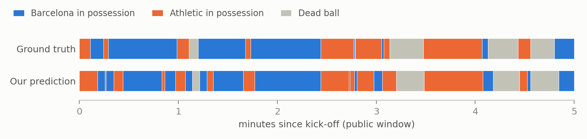
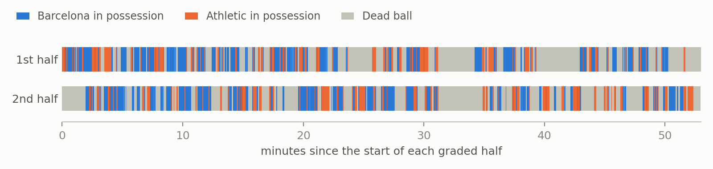

# Frame-level ball possession from automatic tracking

**Team Yamal Fan Boys** · More than a Hack 2027, Phase 1 · FC Barcelona vs Athletic Club

## 1. Summary

We split the task in two, because the two halves fail in different ways:

1. **Is the ball in play?** A hidden Markov model decides alive vs dead from four weak but
   independent automatic signals: whether the **TV broadcast** is showing live play, what the
   tracked ball is doing, how fast the players move, and the Smart Tagging set-piece windows. It
   uses **no labels**: its probabilities are estimated by unsupervised Baum–Welch on the match's own
   automatic observations. The edges of each stoppage are then moved to the moment the ball left
   the pitch (seen or extrapolated) and to the restart kick.
2. **While it is in play, which team has it?** The team that took the restart keeps the ball until
   a player of the other team *holds* it: within <<R>> m of the ball, nearer than any opponent, for
   <<k>> consecutive frames. Loose balls, passes in flight and brief contests leave possession where
   it was.

The pipeline never reads the ground truth. Every tuned number was tuned on external data (IDSSE,
seven professional matches with frame-level labels) or is fixed a priori from the Laws of the Game
or physics; `docs/PROVENANCE.md`, committed before the re-tuning, gives the source of each.
One final check on the public five minutes gives **spellF1 <<SPELL>>** and **macroF1 <<MACRO>>**
(published baseline: 0.326 / 0.621 on the same window).

## 2. Assets and external data

| asset | used for |
|---|---|
| tactical tracking (ATD) | everything: ball, player positions, speeds, team membership |
| broadcast tracking | aligning the broadcast to the tactical clock (§4.2) |
| broadcast homography `valid` flag | "is the TV showing live play?" — one HMM channel |
| Smart Tagging | set-piece windows as one HMM channel |
| published graded halves and second-half kick-off (DATA.md, FAQ.md) | where to write labels; dead ball before frame 113742 |
| **IDSSE** (Bassek et al. 2025, CC BY 4.0, DFL) | tuning: possession radius and frames, minimum stoppage, live-play speed threshold |
| public 5-minute ground truth | one final automatic check, reported in §7; never read by the pipeline |
| videos | not used by the pipeline |
| broadcast ball and near-ball positions | not used (the broadcast shows the pitch on only 66% of frames, with replays) |

## 3. What the data told us

- **Most of the missing ball is dead time, not hidden play.** The tactical ball is missing on 41%
  of graded frames, in long gaps (median 10.7 s). Where it is missing, the broadcast has usually
  cut away and the players are walking.
- **The broadcast director is a dead-ball detector.** In the fitted model (no labels), the
  broadcast has cut away on <<CUT_DEAD>> of dead-ball steps but only <<CUT_ALIVE>> of in-play steps:
  it cuts to close-ups and replays when play stops, and the replay often runs on for a few seconds
  after the restart.
- **The two recordings share one clock per half**: tactical = broadcast + 4014 frames in the first
  half, + 26920 in the second. Replays replace live footage; they do not shift the clock.
- **Brief possessions are part of the definition.** Inspecting the provided public example shows
  possessions under 2 s inside duels, so heavy smoothing cannot be the answer. (No parameter is set
  from ground-truth statistics.)

## 4. Method

### 4.1 Handling missing and noisy tracking (`possession/features.py`)
Positions are converted to metres from the pitch centre. Ball points that jump faster than 40 m/s
away from both neighbours are removed, detections shorter than 3 frames dropped, the track smoothed
over 5 frames and gaps up to 12 frames filled linearly. Longer gaps are left missing on purpose: the
HMM treats "ball not seen" as evidence in its own right, and possession during play is carried
through a gap until the ball is seen with the other team. Player speeds come from positions;
impossible speeds caused by identity switches are discarded.

### 4.2 Broadcast alignment (`possession/broadcast.py`)
Both tracking files use the same pitch coordinates, so a broadcast frame showing live play has a
tactical twin with the same player layout. For anchors every 2 s we search every 5th tactical frame
(same-team nearest-neighbour distance plus the ball), then refine to the exact frame. Most confident
matches fall within ±2 frames of two offsets; the rest are replays, which match the earlier moment
they show. We use one offset per half (the median of the matches near each mode).

### 4.3 Alive / dead (`possession/alivehmm.py`, `possession/pipeline.py`)
- Observations at 5 Hz: broadcast live / cut away / no frame; ball not seen / out / still / slow /
  fast; mean player speed over 3 s on a regular 0.5 m/s grid (missing speed is its own bin); change
  in that speed over the next vs last 3 s; inside a Smart Tagging set-piece window.
- States: alive, and a chain of <<KDEAD>> dead sub-states, so a stoppage lasts at least
  <<KDEAD_S>> s (the 5th percentile of stoppage length in IDSSE).
- Estimation without labels: provisional labels from the tracking alone (ball seen > 0.3 m outside
  the lines = dead; ball seen moving faster than 5 m/s at least 1 m inside the lines and 10 s from
  any such sighting = alive) give the starting tables, then unsupervised Baum–Welch re-estimates all
  emission and transition probabilities from the whole match. A start from neutral tables reaches
  the same parameters, so the result does not depend on how EM is started.
- A frame is dead when the posterior exceeds 0.5. Live slivers under 3 s in which nobody has the
  ball are folded into the surrounding stoppage. The published pre-kick-off period of the second
  half (110808–113741) is dead.

### 4.4 Stoppage edges (`possession/deadball.py`)
The HMM's onset trails the real one when the ball is seen leaving the pitch, so it is moved to:

1. the earliest frame in the 10 s before where the ball is seen crossing a line and staying out
   (≥ 0.3 m beyond it: Law 9, ball wholly over the line, plus tracking error);
2. otherwise the frame the ball left the pitch unseen: last seen within 3 m of a line and moving
   out faster than 2 m/s (or on the line), then not seen for 10 frames, with the crossing
   extrapolated from its speed. Only while play was live: the fastest tenth of the players must
   have been running faster than <<P90>> m/s in the 2 s before (the 10th percentile of that
   statistic during live play in IDSSE), because after a whistle the ball often rolls out while
   everybody has stopped.

There is no pull-back for stoppages without a ball exit (fouls): their lag cannot be measured on
external data, which has no broadcast. The restart moves to the strongest kick of a ball at rest
(< 2 m/s, then > 5 m/s) within ±2 s of the predicted one.

### 4.5 Possession rules (`possession/team.py`)
**Dead ball** is `D`, whoever will restart.

**Restarts.** The team taking the restart owns the ball from the restart frame, decided in this
order:

1. ball seen in the 2 s before the restart at a corner → the team attacking that goal (Law 17); in
   a penalty area → goal kick or defensive free kick by the team defending it (Laws 16, 13; area
   per Law 1);
2. otherwise the team of the player within 2 m of the ball (Law 15: opponents stand at least 2 m
   from a throw-in, and 9.15 m at free kicks and corners);
3. ball not seen but ≥ 9 players in a penalty area → a set piece by the team attacking it;
4. otherwise the first team to control the ball.

Kick-offs follow Law 8: the first half by the team of the player nearest the centre spot, the
second half by the other team.

**During play**: possession passes when the other team holds control (nearest player within
<<R>> m of the seen ball and nearer than any opponent) for <<k>> consecutive frames, dated to the
start of that control. A loose ball, a pass in flight, a deflection or a 50/50 shorter than that
leaves possession with the last team.

## 5. Parameter provenance

| parameter | value | source |
|---|---|---|
| possession radius, frames | <<R>> m, <<k>> frames | IDSSE sweep (§6) |
| minimum stoppage | <<KDEAD_S>> s | IDSSE: 5th percentile of ball-dead run lengths |
| live-play speed threshold for exits | <<P90>> m/s | IDSSE: 10th percentile of the players' 90th-percentile speed during live play |
| HMM probabilities | estimated | unsupervised Baum–Welch on the match's own automatic observations |
| speed / trend bins | 0.5 m/s grid | a priori |
| evidence cap, onset pull-back | none | parameter-free options |
| line crossing 0.3 m; exit 3 m, 2 m/s, 10 frames; kick < 2 then > 5 m/s | as listed | Laws 9, 13, 16, 17 and physics |
| restart radius 2 m; zones; windows; crowd ≥ 9 | as listed | Laws 1, 15, 16, 17; a priori |
| kick-offs | Law 8 | Laws of the Game |
| graded halves, frame 113742 | as published | DATA.md, FAQ.md |

`docs/PROVENANCE.md` gives the full table and the tuning protocol, committed before tuning.

## 6. External tuning on IDSSE

Three IDSSE matches (J03WMX, J03WN1, J03WPY): DFL tracking at 25 Hz with per-frame BallStatus and
BallPossession, from which we build `H`/`A`/`D` labels exactly like the competition's. For the
possession rule the alive/dead mask and the team at each restart come from those labels, so only
the in-play rule is scored, with the official `spell_f1_mean`. Each candidate is scored on the clean
tracking and on a degraded copy (ball unseen on 10% of live frames in 1–3 s blocks, 0.3 m position
noise), and the best mean over the six runs is kept (`scripts/tune_external.py`,
`docs/external_tuning.csv`).

<<SWEEP_TABLE>>

## 7. Results

One final run of the official scorer (`evaluation/run_evaluation.py`, unchanged) on the public five
minutes, after the code and parameters were frozen, with 5–95% bootstrap intervals:

<<RESULT_TABLE>>





Over the match we predict <<NPOSS>> possessions and <<NSTOP>> stoppages; the ball is dead on
<<DEADPCT>> of graded frames.

## 8. Compliance and development history

The organisers clarified the rules in November 2026. Earlier versions of this repository (up to
commit `82884a4`, tagged `pre-new-rules`, public since 20 October) did things the original
RULES.md allowed but the clarified rules do not: the HMM was initialised and partly fitted on the
public five minutes, several constants were chosen by comparing variants on that window, and
outputs were checked against frames of the tactical video, including restart labels made from video
frames by our AI coding assistant. All of that was removed: the pipeline no longer reads the ground
truth (it runs with `evaluation/gt/` deleted), there are no labels or other data made on the
provided game, nothing is checked against the video, and every number was re-derived as in §5–6.
The rules and sources were committed (`docs/PROVENANCE.md`) before the re-tuning, and the public
window was scored once, at the end. The pipeline was built with the help of an AI coding assistant
(Claude Code); the organisers indicated that coding agents may see the data, and we asked them to
confirm this in writing.

## 9. What we tried and dropped

- **Nearest player + majority vote** (the baseline): flickers, and the window that removes the
  flicker also removes short possessions.
- **Viterbi over per-frame touch evidence**, and a ball-free team-shape model: they smoothed away
  the brief possessions the definition keeps.
- **A dead-ball classifier trained on rule-based pseudo-labels from this match:** it learned the
  labelling rule back ("ball not seen ⇒ dead") instead of the stoppage, and training on the
  provided match is not allowed anyway.

## 10. Limitations

- Team errors come from tracking errors near the ball: wrong positions, and identity switches that
  briefly put a player in the other team's slot.
- Very short possessions in duels and aerial balls are unreliable.
- Stoppages that start without the ball leaving the pitch (fouls) are dated by the HMM alone and can
  start a few seconds late.
- IDSSE is corrected optical tracking from the Bundesliga with DFL's own possession definition;
  Metrica's automatic tracking and definition may differ, which is why we also tuned on degraded
  tracking.

## 11. Reproduction

```bash
python3 -m venv .venv && .venv/bin/pip install -r requirements.txt
ln -s /path/to/data/bundle data              # or export MTAH_DATA_DIR=/path/to/data/bundle
.venv/bin/python run.py                      # -> out/Yamal_Fan_Boys.csv, deterministic
.venv/bin/python evaluation/validate_submission.py out/Yamal_Fan_Boys.csv
# optional: re-run the external tuning (needs the IDSSE XML files)
.venv/bin/python scripts/tune_external.py /path/to/idsse
```

A fresh clone reproduces the submitted file byte for byte (md5 `<<MD5>>`).

**Credits.** IDSSE: Bassek, M., Rein, R., Weber, H. & Memmert, D. (2025). An integrated dataset of
spatiotemporal and event data in elite soccer. *Scientific Data* 12, 195.
doi:10.6084/m9.figshare.28196177. Data owner: Deutsche Fußball Liga (DFL). Licence CC BY 4.0.
